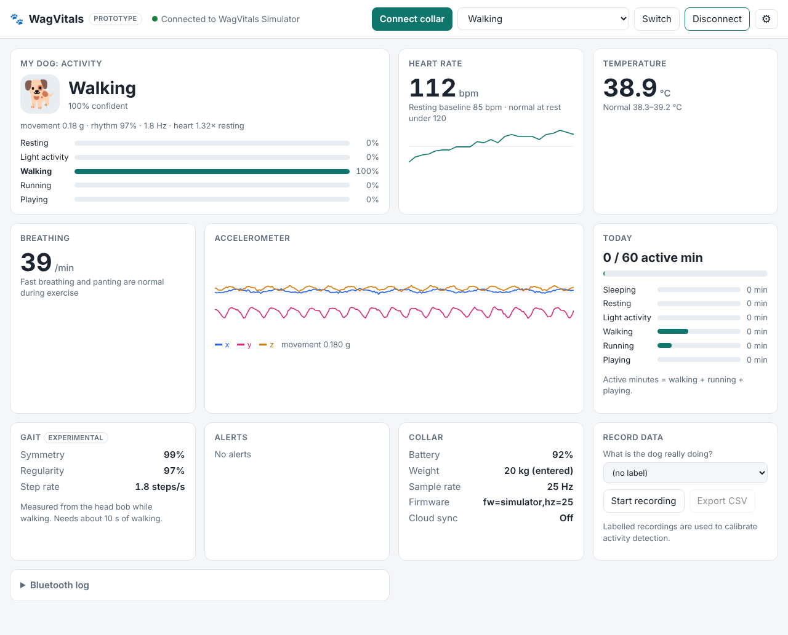

# WagVitals app (desktop prototype)

Companion app for the **WagVitals smart dog collar**. It connects to the
collar's **Nordic nRF52840** over **Bluetooth LE**, shows the dog's vitals live,
and combines the **accelerometer** and **heart-rate sensor** to tell whether the
dog is **sleeping, resting, doing light activity, walking, running or
playing**.



This is a bare-bones prototype for the senior design project. The same web code
runs as a desktop app (Electron) today and will be wrapped as an Android APK
later (see [Roadmap](#roadmap-android-apk)).

## Get the app

**Option A: download a build (no setup).**
On GitHub open **Actions → Build desktop app → Run workflow**. When it
finishes, download the artifact for your system from the run
page:

| System | File | First launch |
| --- | --- | --- |
| Windows | `WagVitals-…-win-x64.exe` (portable, no install) | SmartScreen: **More info → Run anyway** |
| macOS | `WagVitals-…-mac-arm64.dmg` (Apple silicon) or `-x64.dmg` (Intel) | Drag to Applications, then **right-click → Open** |
| Linux | `WagVitals-…-linux-x86_64.AppImage` | `chmod +x` then run |

The builds are unsigned (it's a prototype), hence the warnings. Pushing a tag
such as `v0.1.0` also publishes the files as a GitHub Release.

**Option B: run from source** (needs [Node.js](https://nodejs.org) 22+):

```bash
npm install
npm start          # desktop app
npm run web        # or: browser version at http://localhost:5173 (Chrome/Edge)
npm test           # 41 automated tests
```

## Try it without a collar

Pick a scenario next to **Simulate** (walking, running, playing, sleeping, a
limp, a fever, a stressed dog…) and press it. The simulator produces exactly
the same Bluetooth messages the real collar will send and feeds them through
the same parser and analysis, so everything on screen behaves as it will with
real hardware. Switch scenarios while it runs to see the activity change and
alerts appear.

## Connect the real collar

1. Flash firmware that follows **[docs/BLE_PROTOCOL.md](docs/BLE_PROTOCOL.md)**:
   text lines over the Nordic UART Service, e.g. `A,123456,-12,-981,35`
   (accelerometer) and `H,123500,92,85` (heart rate). A reference Arduino
   sketch for nRF52840 boards is in
   [`firmware/wagvitals_collar/`](firmware/wagvitals_collar/wagvitals_collar.ino)
   (untested starting point).
2. Turn on Bluetooth on the computer, click **Connect collar**, pick the
   collar.
3. Open **Bluetooth log** at the bottom of the page to see the raw lines.

The app finds collars named `WagVitals…` or advertising the Nordic UART
Service. **Settings → List every nearby Bluetooth device** helps when the
firmware uses another name. Standard Heart Rate, Health Thermometer and
Battery services are picked up automatically too.

## What's in the prototype

Features follow what WagVitals describes publicly: a collar wearable tracking
heart rate, temperature and activity, with a first version focused on **gait
analysis**; owners enter their dog's **weight** for **exercise
recommendations**; a **smart bed** that weighs the dog is planned; the collar
stores data and **syncs over Bluetooth**.

| Area | What it does | Code |
| --- | --- | --- |
| Bluetooth | Web Bluetooth link to the nRF52840 (Nordic UART + standard services), auto-reconnect, device picker in the desktop app | `app/js/ble/` |
| Sensors | accelerometer, gyroscope, heart rate (+ signal quality), temperature, breathing rate, battery, weight (smart bed, future) | `app/js/ble/protocol.js`, `app/js/analysis/hub.js` |
| Activity | accelerometer + heart-rate fusion, sleep detection, learns the dog's own resting heart rate | `app/js/analysis/activity.js` |
| Gait (experimental) | head-bob step/stride symmetry while walking, to spot limping early | `app/js/analysis/gait.js` |
| Alerts | fever / heat stroke, racing heart or fast breathing **at rest**, uneven gait, low battery, signal lost | `app/js/analysis/alerts.js` |
| Dog profile | weight, ideal weight, age → expected heart rates and a daily activity goal | `app/js/analysis/profile.js` |
| Record data | labelled CSV export to calibrate the classifier with real dogs | `app/js/recorder.js` |
| Cloud sync | one ~400-byte summary per minute to your own cloud service | `app/js/cloud/`, `cloud/` |

How the activity detection works, and how to calibrate it with real
recordings, is in **[docs/ACTIVITY_DETECTION.md](docs/ACTIVITY_DETECTION.md)**.

## Cloud (using your cloud credits)

`cloud/` holds a small, dependency-free API that stores the per-minute
summaries. Deploy it to **Google Cloud Run** or **Azure Container Apps** with
student credits in one command ([cloud/README.md](cloud/README.md)), then enter
its URL and API key under **Settings → Cloud sync**. Raw sensor data stays on
the device, so cloud usage stays tiny (≈ 0.6 MB per dog per day), and nothing
is lost while offline.

## Project layout

```
app/                    the app (plain HTML/CSS/JS, no build step)
  index.html, styles.css
  js/config.js          UUIDs, thresholds, normal vital ranges (tune here)
  js/ble/               protocol parser, Web Bluetooth transport, simulator
  js/analysis/          features, activity fusion, gait, alerts, profile, engine
  js/cloud/             per-minute summaries + upload queue
electron/               desktop shell (window, Bluetooth device picker)
cloud/                  cloud API + Dockerfile
firmware/               reference nRF52840 sketch (untested)
docs/                   Bluetooth protocol, activity-detection notes
test/                   automated tests (node --test)
.github/workflows/      tests on every push; desktop builds on demand
```

## Roadmap: Android APK

Not built yet (planned for a later phase). The plan, which needs no rewrite:

1. Add [Capacitor](https://capacitorjs.com): `npm i @capacitor/core @capacitor/cli @capacitor/android`,
   then `npx cap init WagVitals com.wagvitals.prototype --web-dir app` and `npx cap add android`.
2. Android's WebView has no Web Bluetooth, so add
   `@capacitor-community/bluetooth-le` and write `app/js/ble/capacitorBle.js`
   with the same interface as `webBluetooth.js` (`connect`, `disconnect`,
   `send`, and `sample` / `line` / `status` events). Everything above the
   transport stays the same.
3. Declare the `BLUETOOTH_SCAN` / `BLUETOOTH_CONNECT` permissions, then
   `npx cap open android` and build the APK in Android Studio.

The layout is already responsive for phone screens.

## Known limitations

- Activity thresholds are tuned on simulated data, not real dogs yet.
  Calibrate with the recorder before trusting them.
- Gait symmetry is a research-based proxy, not a diagnosis.
- No real Bluetooth hardware was available while building this. The Bluetooth
  code is tested against a fake nRF52840 GATT server, and the desktop app was
  checked to start, find no adapter, and fail cleanly.
- Data is stored per computer (browser storage). The cloud server's file
  storage is temporary on Cloud Run/Azure (see cloud/README.md).
- Linux needs BlueZ; the app enables Chromium's Web Bluetooth flag
  automatically.

## Background research

Public information about WagVitals used for this prototype (wagvitals.com
itself could not be fetched while building it):

- [LaunchNET Supports: WagVitals, Kent State University](https://www.kent.edu/launchnet/news/launchnet-supports-wagvitals)
- [How WagVitals is Changing the Future of Pet Health, WEDC](https://wedc.org/how-wagvitals-is-changing-the-future_of-pet-health/)
- [WagVitals develops AI-enhanced smart collar to monitor dog mobility, mkestartup.news](https://mkestartup.news/wagvitals-develops-ai-enhanced-smart-collar-to-monitor-dog-mobility/)
